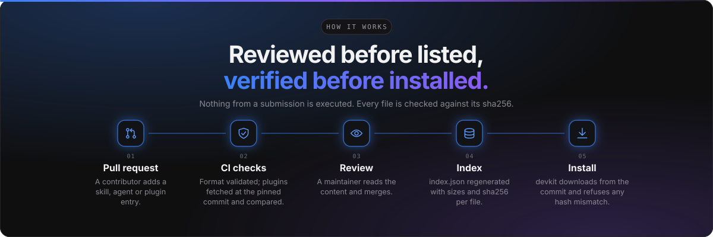

<div align="center">


<br>

[](https://github.com/lucaseduardocrp/agent-devkit-hub/actions/workflows/ci.yml)


**For [ADK](https://github.com/lucaseduardocrp/agent-devkit), Claude Code, Codex and any MCP client.**

[Quick start](#-quick-start) ·
[What is inside](#-whats-inside) ·
[How it works](#%EF%B8%8F-how-it-works) ·
[Contribute](#-contributing) ·
[Admission rules](#%EF%B8%8F-admission-rules)

</div>

---

## ✨ What is the ADK Hub?

The Hub is a **curated, reviewed and integrity-checked** collection of reusable building blocks
for AI assistants. You can browse it on the website (`/hub/skills`, `/hub/agents`,
`/hub/plugins`), read every file before installing anything, and install with a single command.

- 🔍 **Transparent**: every file of every item is public and shown as it is.
- 🔐 **Verified**: files are checked against a sha256 before they touch your machine.
- 👀 **Reviewed**: nothing is listed without a maintainer reading and merging it.
- 📌 **Pinned**: plugins are locked to an exact commit, never to a branch or a tag.

## 🚀 Quick start

Install the CLI and use it:

```bash
npm install -g @agent-devkit/cli
```

```bash
# 🔎 Find and install a skill
devkit skills search playwright
devkit skills install playwright-flaky-test-triage     # --client codex|agents, --scope project

# 🤖 Install an agent into the active ADK workspace
devkit agents install qa-test-designer

# 🔌 Install a plugin
devkit plugins install <name>

# 🧰 Manage what you installed
devkit skills installed
devkit skills update
devkit skills remove <name>
```

> 💡 **Prefer a UI?** Agents can also be installed from the **Hub** tab of the Agents page in ADK,
> or by an assistant through the `agents_hub_install` MCP tool.

## 📦 What's inside

There are three kinds of items (plus built-in skills that ship with ADK itself):

| | Kind | Lives in | What gets installed |
| :-: | --- | --- | --- |
| 🧠 | **Skill** | This repository, `skills/<name>/` | The folder, into the client's skills folder, after every file is checked against the sha256 in the index |
| 🏠 | **Built-in skill** | The ADK repository, `apps/Mcp/skills/<name>/` | Same as a skill; these also ship with `devkit` itself |
| 🤖 | **Agent** | This repository, `agents/<name>/AGENT.md` | A custom agent in an ADK workspace, after the file is checked against the sha256 in the index |
| 🔌 | **Plugin** | The author's repository, listed by `plugins/<name>.json` at an exact commit | Its skills and subagents (fetched at that commit) and the commands that register its MCP servers. Its subagents can also be installed as ADK workspace agents |

### Available today

**Skills**

| Skill | Use it when |
| --- | --- |
| [`api-contract-checks`](skills/api-contract-checks) | You need scenarios or automated checks for a REST API from an OpenAPI document, a route list or example requests |
| [`bug-report-from-e2e-failure`](skills/bug-report-from-e2e-failure) | An E2E test failed because of a real defect and you want a bug report or issue written from the failure |
| [`exploratory-testing-charter`](skills/exploratory-testing-charter) | You want to plan or run an exploratory session, or turn session notes into findings |
| [`playwright-flaky-test-triage`](skills/playwright-flaky-test-triage) | A Playwright test passes and fails without code changes, or before quarantining one |
| [`test-cases-from-acceptance-criteria`](skills/test-cases-from-acceptance-criteria) | You want test cases, edge cases and negative cases from a user story, PBI or acceptance criteria |

**Agents**

| Agent | Role | What it does |
| --- | --- | --- |
| [`qa-test-designer`](agents/qa-test-designer/AGENT.md) | `qa` | Turns PBIs, specs and acceptance criteria into traceable test cases, BDD scenarios and risk-based coverage |
| [`technical-writer`](agents/technical-writer/AGENT.md) | `documentation` | Documents features, APIs and procedures in the Brain from specs, code and existing pages, without unsupported claims |

## ⚙️ How it works

<div align="center">

</div>


1. **Pull request.** [CI](.github/workflows/ci.yml) validates the format. For plugins it fetches
   the repository at the pinned commit and checks that it ships exactly what the entry declares.
   Nothing from the submission is executed.
2. **Review.** A maintainer reviews the content and merges.
3. **Index.** [The index workflow](.github/workflows/index.yml) regenerates `index.json`: every
   skill file with its size and sha256, pinned to the merge commit. Built-in skills are read from
   the ADK repository and pinned to the last ADK commit that changed them. The website and
   `devkit` read this file.
4. **Install.** `devkit` and the website download skill files from that commit and refuse any
   file whose hash differs. Plugins are fetched at their pinned SHA, and `git rev-parse HEAD` must
   match it.

> ⚠️ **Never edit `index.json` by hand.** Pull requests that touch it fail CI.

## 🤝 Contributing

Contributions are welcome. Open a pull request that adds or changes a skill under `skills/`, an
agent under `agents/` or a plugin entry under `plugins/`. Check it locally first (Node 20 or
later, no install needed):

```bash
node tools/cli.mjs validate
```

Pick what you want to submit:

- [🧠 Submitting a skill](#-submitting-a-skill)
- [🤖 Submitting an agent](#-submitting-an-agent)
- [🔌 Submitting a plugin](#-submitting-a-plugin)

See also [CONTRIBUTING.md](CONTRIBUTING.md) for the short checklist.

### 🧠 Submitting a skill

Create `skills/<name>/SKILL.md`. The folder name is the skill name: lowercase words joined by
hyphens. Reference files may sit next to it (`references/*.md`, examples, small scripts).

```markdown
---
name: my-skill
description: Use when <the situation>. Say when the assistant should load it, in up to 1024 characters.
category: test-design
author: Your Name
version: 1.0.0
license: MIT
tags: [playwright, accessibility]
toolsets: [e2e, testplans]
---

# My skill

One paragraph on what the skill achieves (it becomes the summary on the hub).

## Procedure
...
```

| Field | Rule |
| --- | --- |
| `name` | Same as the folder |
| `description` | 20 to 1024 characters; starts with *when* to use it |
| `category` | One of the `skills` ids in [categories.json](categories.json) |
| `author`, `license` | Required; `license` is an SPDX id (`MIT`, `Apache-2.0`, ...) |
| `version` | SemVer; bump it in every change |
| `tags` | Optional, up to 8 lowercase words |
| `toolsets` | Optional ADK MCP toolsets the skill calls (`brain`, `spec`, `testplans`, `e2e`, `pbi`, `issues`, ...) |
| `tier` | Leave it out (`community`). Only maintainers set `official` |

<details>
<summary><b>📏 File limits and front matter rules</b></summary>

<br>

- Front matter is one `key: value` per line; nested keys and multi-line values are refused.
- Files must be text (`.md`, `.txt`, `.json`, `.yaml`, `.csv`, `.html`, `.js`, `.ts`, `.py`,
  `.sh`, `.ps1`, `.feature`, `.sql`, ...).
- At most **50 files**, **256 KB each** and **1 MB in total**.
- No hidden files and no symbolic links.
- The whole skill is public: the website shows every file as it is.

</details>

### 🤖 Submitting an agent

An agent is an ADK workspace agent: a persona and rules that ADK runs on Issues, in the Test
Playground and in workflows. Create `agents/<name>/AGENT.md` (the folder holds only that file):

```markdown
---
name: my-agent
description: What the agent does, in 20 to 500 characters.
role: qa
temperature: 0.1
author: Your Name
version: 1.0.0
license: MIT
tags: [qa, bdd]
toolsets: [pbi, testplans]
---

# My agent

The instructions ADK gives the model: who the agent is, how it works and its rules.
```

| Field | Rule |
| --- | --- |
| `name` | Same as the folder |
| `role` | `qa`, `documentation`, `refactor` or `custom` (the agent role in ADK) |
| `temperature` | Optional, 0 to 2; ADK uses 0.2 when it is left out |
| `description`, `author`, `version`, `license`, `tags`, `toolsets`, `tier` | As for skills |

Everything after the front matter becomes the agent's instructions, at least 200 characters.

> ℹ️ **The model is not set here:** each workspace picks it. When a workspace updates an installed
> agent, its name, description and instructions are replaced by the new version; its model,
> temperature, role and place in the hierarchy are kept.

### 🔌 Submitting a plugin

A plugin is a folder in **your own repository**. Start from [templates/plugin](templates/plugin):

```
my-plugin/
├── adk-plugin.json          { "name", "version", "description" }
├── skills/<name>/SKILL.md   skills (name and description are required)
├── agents/<name>.md         subagents (installed for Claude Code)
├── .mcp.json                { "mcpServers": { ... } } the skills rely on
└── README.md
```

Then add `plugins/<name>.json` here ([schema](schema/plugin.schema.json) for completion in
editors):

```json
{
  "$schema": "../schema/plugin.schema.json",
  "name": "jira-qa",
  "title": "Jira QA",
  "description": "Triage Jira issues and link them to ADK test plans.",
  "repo": "https://github.com/you/adk-jira-qa",
  "sha": "<full 40-character commit SHA>",
  "subdir": "",
  "version": "1.0.0",
  "maintainer": "you",
  "category": "integrations",
  "license": "MIT",
  "disclosure": "Sends issue keys and summaries to your Jira site. Needs a Jira API token.",
  "capabilities": {
    "skills": ["jira-triage"],
    "agents": [],
    "mcpServers": ["jira"],
    "requiresEnv": ["JIRA_TOKEN"]
  }
}
```

Run the same check CI runs, against your pinned commit:

```bash
node tools/cli.mjs verify-plugin plugins/jira-qa.json
```

## 🛡️ Admission rules

Trust is the whole point of the Hub, so every entry has to follow these rules.

| # | Rule | In short |
| :-: | --- | --- |
| 1 | **Reviewed merge only** | Entries are added through a pull request reviewed and merged by a maintainer. There is no self-service publishing. |
| 2 | **Exact commit pins** | Plugins pin a full 40-character SHA. Branches, tags and short SHAs are refused. Updating is a new pull request that changes the SHA (and `version`), and the reviewer reads the upstream changes between the two commits. |
| 3 | **Declared capabilities match reality** | `capabilities` lists exactly the skills, subagents and MCP servers the plugin ships at the pinned commit, and every environment variable its `.mcp.json` uses. CI fails the entry otherwise. |
| 4 | **No self-updating code, no floating versions** | MCP servers pin exact package versions (`pkg@1.2.3`, never `@latest`), and nothing downloads code that was not reviewed. |
| 5 | **Reviewable source only** | No compiled binaries, bytecode, archives or minified bundles that cannot be read. CI rejects ELF, PE, Mach-O and WebAssembly files and `.pyc`. |
| 6 | **Secrets come from the user** | Plugins read credentials from environment variables declared in `requiresEnv`. They never read other tools' credential files, and never commit tokens. |
| 7 | **Risky behaviour is disclosed** | Network calls, data sent to third parties, shell commands and stored credentials go in `disclosure` and in the plugin README. Telemetry is opt-in. |
| 8 | **External effects are confirmed** | Skills ask the user before publishing, creating tickets, sending messages or deleting data, and treat content read from external systems as data. |
| 9 | **Owner submissions** | Plugins are submitted by the owner or a major contributor of the repository. One listing per plugin; forks are listed only when materially different. |
| 10 | **Truthful metadata** | Names do not impersonate other projects or vendors; `official` and `verified` tiers are set by maintainers only. |

## 🗑️ Removals

An entry pulled for security or policy reasons is deleted and recorded in
[removed.json](removed.json) (`name`, `repo`, `reason`, `date`). `devkit` refuses to install
anything matching a removed name or repository, and CI refuses to list it again.

An entry that is simply unmaintained is deleted without being blocked. Users who installed it keep
their copy, and `devkit … update` tells them it left the hub.

🚩 **Found a problem?** Open an issue in this repository titled `[hub] <name>: ...`, or report it
privately through the **Security** tab for anything malicious.

## 🛠️ Maintainer notes

<details>
<summary><b>Tooling, hosting and workflows</b></summary>

<br>

- **Tooling:** `tools` is dependency-free Node. `npm test --prefix tools` runs its tests.
- **Hosting:** the hub is served from `lucaseduardocrp/agent-devkit-hub`; the index workflow only
  runs there. `devkit` reads `ADK_HUB_URL` (or `--hub-url`, a URL or a local file) and the website
  `VITE_ADK_HUB_URL` to use another index.
- **Built-in skills:** CI and the index workflow check out the ADK repository and pass it with
  `--adk`. ADK's `hub-skills` workflow validates them against this repository on its own pull
  requests and, on main, sends a `repository_dispatch` (`adk-skills`) so the index picks changes
  up at once instead of at the daily run. That dispatch needs the `HUB_DISPATCH_TOKEN` secret in
  the ADK repository (a fine-grained token with *Contents: read and write* on this repository).
- **Line endings:** `skills/**` is stored with LF line endings (`.gitattributes`) so the bytes on
  disk, in Git and on raw.githubusercontent.com are identical and the hashes match.

</details>

---

<div align="center">

Made for the [ADK](https://github.com/lucaseduardocrp/agent-devkit) community ·
[Report an issue](https://github.com/lucaseduardocrp/agent-devkit-hub/issues) ·
[License](LICENSE)

</div>
